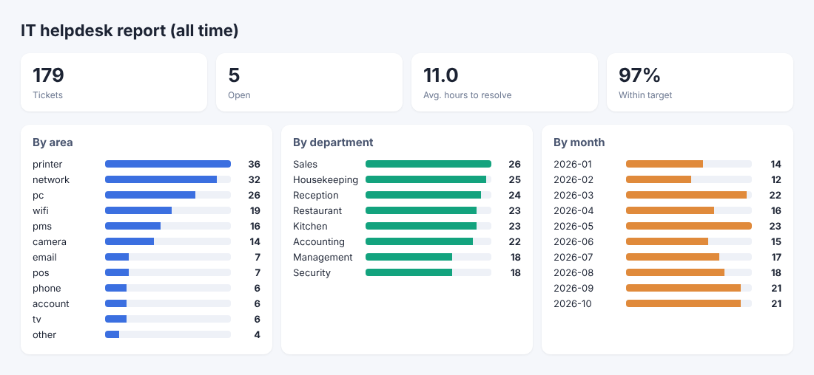

# IT Helpdesk Tracker

**سامانه‌ی ثبت درخواست‌های IT** — ثبت و پیگیری کارهای پشتیبانی (چه کسی، کدام بخش، چه حوزه‌ای، چه اولویتی)، بستن تیکت با توضیح و گزارش ماهانه برای اینکه معلوم شود وقت واحد IT کجا صرف می‌شود.

When you're the only IT person in a hotel, requests arrive by phone, in the corridor and on WhatsApp, and at the end of the month nobody can say how much was done. This command-line tracker logs every job in a local SQLite file and turns it into reports for management: how many tickets, which departments and areas take the most time, and how many were fixed within the target time.



## Features

- Open, list and close tickets with a resolution note
- 12 hotel IT areas (network, Wi-Fi, PCs, printers, cameras, phones, PMS, POS, TV...) and 4 priorities
- Target resolution time per priority (urgent 1h, high 4h, normal 24h, low 72h) and the % met
- Reports by area, department and month, in the terminal or as an HTML page for management
- CSV export for Excel
- A single SQLite file: nothing to install, easy to back up

## Usage

```sh
python3 helpdesk.py add "Printer not printing" --dept Reception --area printer --priority high --by "Front desk"
```
```
Opened ticket #1
```

```sh
python3 helpdesk.py list
python3 helpdesk.py close 1 "Cleared the queue and restarted the spooler"
python3 helpdesk.py report --month 2026-10
python3 helpdesk.py report --html report.html --csv tickets.csv
```

Try it with sample data (179 tickets over 10 months):

```sh
python3 helpdesk.py --db demo.db demo
python3 helpdesk.py --db demo.db report
```

```
IT helpdesk report (all time)
=============================
Tickets: 179  closed: 174  open: 5
Average time to resolve: 11.0 h   Resolved within target: 97%

By area:
  printer         36  ████████████████████████████
  network         32  █████████████████████████
  pc              26  ████████████████████
  wifi            19  ███████████████
  ...
```

## Tests

```sh
python3 -m unittest discover -s tests
```
