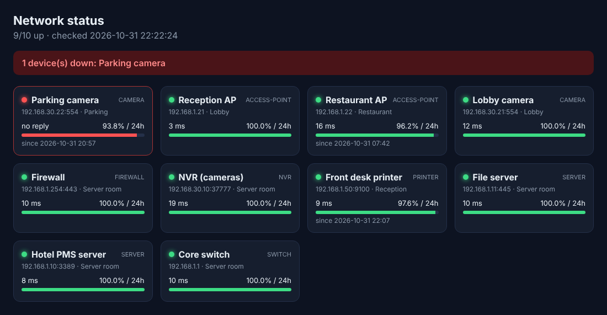

# Network Uptime Monitor

**مانیتورینگ تجهیزات شبکه** — بررسی مداوم سوئیچ‌ها، اکسس‌پوینت‌ها، دوربین‌ها، پرینترها و سرورها با Ping یا پورت TCP، ذخیره‌ی تاریخچه و ساخت داشبورد وضعیت HTML.

In a hotel, the first sign that a camera or access point is down is usually a guest or a manager complaining. This tool checks every device on a schedule, keeps a history in SQLite, and writes a dashboard you can leave open on a screen in the IT room.



## Features

- Devices listed in a simple CSV ([`devices.csv`](devices.csv)): name, IP, type, optional TCP port, location
- **Ping** check, or a **TCP port** check for devices that block ICMP (RTSP 554 for cameras, 9100 for printers, 3389 for RDP...)
- All devices are checked in parallel
- History in SQLite: uptime % for the last 24 hours, 7 days and 30 days, and "down since" times
- Self-contained `dashboard.html` (no internet or JS needed, refreshes every minute)
- Exit code `2` when something is down, so it can run from cron or Task Scheduler and trigger an alert

## Usage

```sh
# one round of checks, writes dashboard.html
python3 monitor.py devices.csv

# keep checking every 60 seconds
python3 monitor.py devices.csv --every 60

# uptime report from the history (example output below)
python3 monitor.py devices.csv --report
```

```
Device                       24h       7d      30d
Core switch              100.00%  100.00%  100.00%
Restaurant AP             96.19%   99.45%   99.87%
Parking camera            93.77%   99.11%   99.79%
...
```

### Run it every 5 minutes with cron

```
*/5 * * * * cd /opt/uptime && python3 monitor.py devices.csv --out /var/www/html/status.html
```

## Tests

```sh
python3 -m unittest discover -s tests
```
